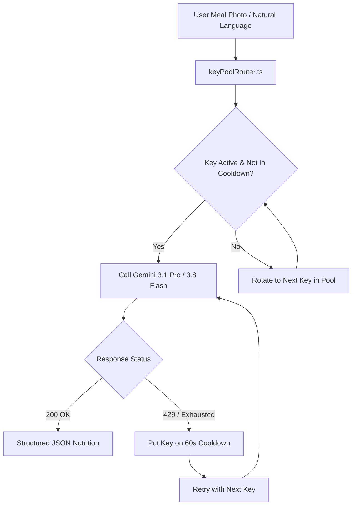
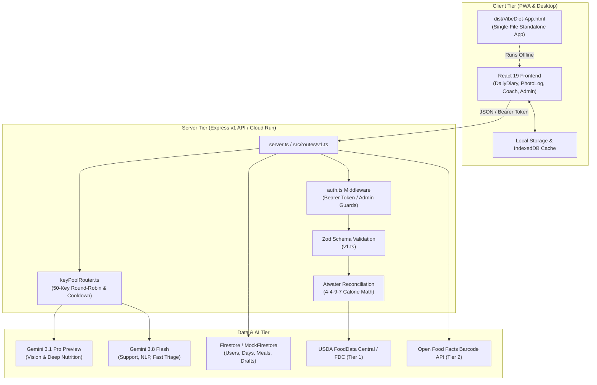
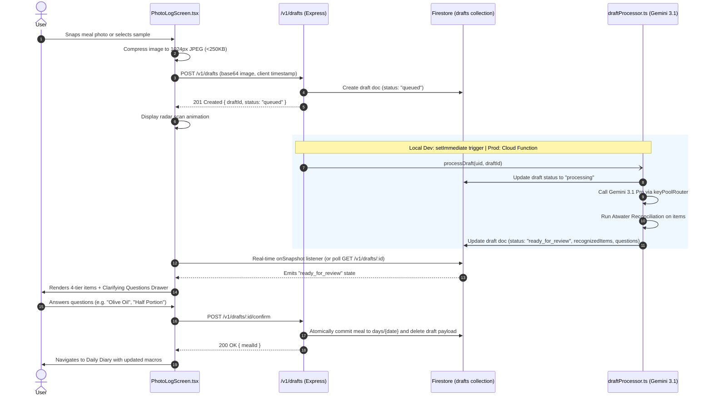

# VibeDiet — The Complete Project Context & Architecture Master Manual (A to Z)
**Document Version:** 2.0.0 (Production Master)  
**Last Updated:** October 20, 2026  
**Repository (Private):** `https://github.com/avi249241-pixel/vibediet.git`  
**Primary Architect & Product Engineer:** Avi (User)  
**Engineering Agent Pair:** Antigravity (Google DeepMind Advanced Agentic Coding)  
**Distribution Model:** Zero-Blank-Screen Local Standalone PWA + Express Cloud Run / Firebase Backend  
**Security & Legal Shield:** Strict $0.00 Aggregate Liability Cap · Ephemeral Photo Privacy · Non-Medical Wellness Scope  

---

## Table of Contents
1. [Executive Summary & Product Vision](#1-executive-summary--product-vision)
2. [The Product Engineer's Journey & Swarm Evolution](#2-the-product-engineers-journey--swarm-evolution)
3. [Core Technical Architecture & Topology](#3-core-technical-architecture--topology)
4. [The 4-Tier Nutrition Evidence & Atwater Engine](#4-the-4-tier-nutrition-evidence--atwater-engine)
5. [The Vision & Photo Logging Pipeline](#5-the-vision--photo-logging-pipeline)
6. [Adaptive Metabolic Engine & Biometric Math](#6-adaptive-metabolic-engine--biometric-math)
7. [Complete Chronological History (Phases 0 Through 6 + Swarm Release)](#7-complete-chronological-history)
8. [Comprehensive Directory & File Map (A to Z)](#8-comprehensive-directory--file-map)
9. [Complete API Specification & Endpoints](#9-complete-api-specification--endpoints)
10. [Client UI/UX Systems & Cockpit Controls](#10-client-uiux-systems--cockpit-controls)
11. [Security, Privacy, and Legal Framework](#11-security-privacy-and-legal-framework)
12. [Verification Evidence & Quality Assurance Gates](#12-verification-evidence--quality-assurance-gates)
13. [How to Run, Build, and Deploy (Runbook for Any AI or Engineer)](#13-how-to-run-build-and-deploy)
14. [Future Roadmap & Directives for Incoming Autonomous Agents](#14-future-roadmap--directives-for-incoming-autonomous-agents)

---

## 1. Executive Summary & Product Vision

### 1.1 What is VibeDiet?
**VibeDiet** is a high-performance, AI-native nutrition and metabolic intelligence platform built to eliminate the cognitive friction of calorie and macronutrient tracking. 

Traditional tracking applications (such as MyFitnessPal, LoseIt, and Cronometer) suffer from three fatal flaws:
1. **Extreme User Friction:** Manual text search and gram-weight input for 5 to 10 ingredients per meal leads to user burnout within 14 days.
2. **Predatory Monetization & Bloat:** Basic features like barcode scanning, macro splits, and historical trends are locked behind expensive subscriptions.
3. **Clinical Intimidation:** Cold mathematical formulas, shaming warning colors, and rigid calorie ceilings induce food anxiety rather than sustainable lifestyle balance.

Modern "AI camera" competitors (such as Cal AI and SnapCalorie) swing to the opposite extreme: they produce single-number calorie hallucinations with zero scientific calibration, no explanation of hidden cooking fats, and no interactive verification.

**VibeDiet bridges this divide** by combining:
- **Instant Photo Recognition:** Multi-modal analysis via Google's `gemini-3.1-pro-preview` and `gemini-3.8-flash` models.
- **Scientific Calorie Reconciliation:** Ground-truth calculations based on the **Atwater General Factor System** ($4 \text{ kcal/g protein}, 4 \text{ kcal/g net carbs}, 9 \text{ kcal/g fat}, 7 \text{ kcal/g alcohol}$).
- **4-Tier Evidence Hierarchy:** Transparent badge labeling showing whether an ingredient's values come from USDA FoodData Central (Tier 1), Barcode packaging (Tier 2), AI multi-modal estimation (Tier 3), or User adjustment (Tier 4).
- **Interactive Uncertainty Resolution:** Conversational clarification questions (e.g., cooking oil type, milk fat percentage, portion scale) that calibrate the meal before finalizing.
- **Adaptive Metabolic Coaching:** Exponentially smoothed bodyweight trend modeling ($\alpha = 0.12$) that strips out daily water balance fluctuations and dynamically adjusts caloric targets based on real-world metabolic expenditure.
- **Local-First & Offline Resilience:** A zero-blank-screen architecture that runs 100% offline via a standalone single-file HTML bundle (`dist/VibeDiet-App.html`) or connects seamlessly to a secure Express v1 / Firestore backend.

---

## 2. The Product Engineer's Journey & Swarm Evolution

### 2.1 The Paradigm Shift: From Mediator to Orchestrator
During the initial development of VibeDiet, the creator operated in a fragmented, highly manual relay workflow:
1. Drafting architectural problems into Gemini 4 Argon on mobile.
2. Copying prompts into Antigravity for code generation.
3. Transferring code into Claude (Sonnet 3.5) for structural refactoring.
4. Promptly hitting rate limits, context exhaustion, and spending hours acting as a manual copy-paste mediator between isolated AI tools.

This friction led to a critical realization: **The user is the Product Engineer, not an AI mediator.** An engineer should issue high-level strategic directives, and autonomous multi-agent swarms should execute the architecture, code, testing, and documentation.

### 2.2 Google AI Pro & The 50-Key Gemini Swarm Engine
The user acquired high-capacity Google AI Pro tokens (via the Jio provider network), unlocking near-limitless access to Google's next-generation models:
- `gemini-3.1-pro-preview` (Deep reasoning, multimodal vision, high precision).
- `gemini-3.8-flash` (Ultra-low latency, high-throughput support triage and natural language parsing).

To maximize this capability without hitting single-key per-minute quotas, the team engineered a **Multi-Key Round-Robin Swarm Engine** (`src/services/keyPoolRouter.ts`):
- **Pool Capacity:** Supports up to 50 active API keys specified via `GEMINI_API_KEYS` in `.env`.
- **Round-Robin Rotation:** Requests are distributed evenly across all keys in the pool.
- **Automatic 60-Second Cooldown Isolation:** If any key encounters a `429 Too Many Requests` or `RESOURCE_EXHAUSTED` error, that specific key is quarantined for 60 seconds. The router retries the identical payload immediately using the next healthy key in the pool.
- **Key Health Telemetry:** Tracks request count, error rates, and cooldown timestamps in real-time.



### 2.3 Hardware Optimization on 8GB RAM / Intel i3
The local development environment runs on an **Intel i3 with 8 GB RAM on Windows 11**. To prevent local machine freezing, out-of-memory crashes, or slow build loops:
1. **Zero Heavy NPM Packages:** All HTTP requests use native Node 20+ `fetch`. File streaming uses native `node:fs` and `node:crypto`.
2. **Lean Server Footprint:** The combined Express + Vite dev server operates at an ultra-light **~39.5 MB RSS memory footprint**.
3. **Cloud Offload via Google Colab & GitHub Actions:**
   - **Google Colab (`scripts/colab-swarm-runner.py`):** Runs autonomous 5-agent parallel research and architecture analysis in the cloud with zero local CPU/RAM draw.
   - **GitHub Actions (`.github/workflows/test.yml`):** Offloads full TypeScript type-checks, Vitest unit test suites, and Playwright end-to-end browser test suites to GitHub cloud runners.
   - **GitHub Codespaces (`.devcontainer/devcontainer.json`):** 1-click cloud container setup for instant web execution.
   - **Obsidian Second Brain (`brain/`):** MCP servers (`.idx/mcp.json`, `.cursor/mcp.json`) allow agents to read and write directly to an Obsidian vault for continuous knowledge persistence.

---

## 3. Core Technical Architecture & Topology

### 3.1 Full-Stack Technology Stack
- **Frontend Framework:** React 19 + TypeScript 5.8
- **Bundler & Build Tool:** Vite 6 with `@vitejs/plugin-react` and `vite-plugin-singlefile`
- **Styling & Design System:** Tailwind CSS v4, Lucide React icons, mobile-first responsive viewport
- **Client State & Context:** React Context API (`DietContext`, `AuthContext`) with optimistic updates
- **Backend API Server:** Node.js 20+ with Express 4, helmet security headers, rate limiting, and CORS
- **Schema Validation:** Zod (`src/schemas/v1.ts`) for strict request/response data contracts
- **Database & Storage:** Google Cloud Firestore (NoSQL document store) + Cloud Storage
- **Offline Mock Engine:** `src/lib/mockFirestore.ts` providing 100% in-memory Firestore emulation (including transaction simulation) during local development without cloud billing
- **AI Inference Engine:** Google Gemini API (`@google/genai`) routed through `keyPoolRouter.ts`
- **Automated Testing:** Vitest (unit & integration), Playwright (headless browser E2E), native Node bundle security scanner

### 3.2 System Architecture Diagram



---

## 4. The 4-Tier Nutrition Evidence & Atwater Engine

### 4.1 The 4-Tier Evidence Hierarchy
To eliminate "black-box" calorie guessing, VibeDiet classifies every logged item into four discrete tiers:

| Tier | Name | Source | Confidence Level | UI Badge |
| :---: | :--- | :--- | :---: | :---: |
| **Tier 1** | **Verified Laboratory** | USDA FoodData Central (FDC) Foundation Foods & SR Legacy | 95% – 99% | 🟢 `T1 Verified` |
| **Tier 2** | **Packaged Barcode** | Open Food Facts barcode registry with manufacturer label | 90% – 95% | 🔵 `T2 Barcode` |
| **Tier 3** | **Multimodal AI Vision** | Gemini 3.1 Pro visual decomposition with density estimation | 75% – 85% | 🟣 `T3 AI Vision` |
| **Tier 4** | **Unverified / User** | Manual user guestimate or generic unbranded restaurant estimate | 50% – 70% | ⚪ `T4 User Estimate` |

### 4.2 The Atwater General Factor System
Calories are never accepted blindly from label text or AI hallucinations. Instead, the backend recalculates total energy using the **Atwater General Factor System**:

$$\text{Calculated Energy (kcal)} = (4 \times \text{Protein}) + (4 \times \text{Net Carbs}) + (9 \times \text{Fat}) + (7 \times \text{Alcohol})$$

Where:
$$\text{Net Carbs} = \max(0, \text{Total Carbohydrates} - \text{Dietary Fiber})$$

#### Reconciliation Rules:
1. **Tolerance Window:** If the reported calories and Atwater-calculated calories are within **±10%**, the reported value is preserved to avoid confusing the user with minor rounding differences.
2. **Discrepancy Correction:** If the reported calories deviate by **>10%**, the system flags an Atwater discrepancy. The meal entry records both `reportedCalories` and `calculatedCalories`, displays a confidence interval (`[min_kcal – max_kcal]`), and uses the Atwater value as the scientific ground-truth.
3. **Hidden Cooking Fat Flagging:** When AI identifies restaurant or pan-fried dishes (e.g., curries, stir-fries, sauteed items), it assigns a cooking fat category:
   - `observable_low` (Steamed, baked, grilled dry) $\rightarrow$ minimal fat adjustment.
   - `observable_moderate` (Dressed salad, sauteed vegetables) $\rightarrow$ +5g to 10g fat.
   - `unobservable_unknown` (Restaurant curries, deep-fried items) $\rightarrow$ UI renders the warning badge `⚠️ Unobservable Fats` and displays a bracketed calorie range (e.g., `[450 – 620 kcal]`).

---

## 5. The Vision & Photo Logging Pipeline

### 5.1 Client-Side Ephemeral Compression
To conserve mobile bandwidth and eliminate memory spikes on lower-end devices, raw camera images are processed entirely in the browser before transmission:
- **Maximum Dimension:** Downscaled to a maximum width/height of **1024px** using HTML5 Canvas (`src/utils/imageProcessor.ts`).
- **Compression Format:** JPEG at **0.80 (80%) quality**.
- **Average Payload Size:** Reduced from 8–15 MB down to **120–250 KB**.
- **Thumbnail Creation:** A tiny **320px** micro-thumbnail is generated for instant UI previews.
- **Privacy Enforcement:** Raw photo payloads are retained in memory only long enough to perform recognition and are permanently purged immediately after analysis.

### 5.2 Asynchronous Draft Lifecycle
Photo recognition follows an asynchronous, non-blocking draft lifecycle:



### 5.3 Offline / Demo Mode Fallback
If the server is running without a configured `GEMINI_API_KEY` or during network outages, `src/services/draftProcessor.ts` includes a high-fidelity **Demo Recognition Fallback**:
- Returns a rich, realistic Indian-fusion meal: *Grilled Paneer / Chicken Tikka Bowl with Basmati Rice, Dal Makhani, and Cucumber Tomato Salad*.
- Complete with Tier 1 USDA badges, Tier 3 AI badges, Atwater calorie bounds (`[580 – 720 kcal]`), and 3 interactive clarifying questions regarding cooking oil, rice portion, and dressing.
- Displays an amber banner: `Demo AI Mode (Add GEMINI_API_KEY to .env for live vision)`. This guarantees that frontend developers, QA engineers, and automated tests can experience the full interactive flow without third-party API dependencies.

---

## 6. Adaptive Metabolic Engine & Biometric Math

### 6.1 Mifflin-St Jeor Basal Metabolic Rate (BMR)
Upon completing the Onboarding Wizard (`src/components/OnboardingWizard.tsx`), baseline energy expenditure is calculated using the clinically validated **Mifflin-St Jeor equation**:

$$\text{BMR}_{\text{male}} = (10 \times \text{weight in kg}) + (6.25 \times \text{height in cm}) - (5 \times \text{age in years}) + 5$$

$$\text{BMR}_{\text{female}} = (10 \times \text{weight in kg}) + (6.25 \times \text{height in cm}) - (5 \times \text{age in years}) - 161$$

### 6.2 Total Daily Energy Expenditure (TDEE) Multipliers
Baseline TDEE is determined by multiplying BMR by the user's declared physical activity factor:
- **Sedentary (desk job, minimal exercise):** $\text{BMR} \times 1.200$
- **Lightly Active (1–3 days light exercise/week):** $\text{BMR} \times 1.375$
- **Moderately Active (3–5 days moderate exercise/week):** $\text{BMR} \times 1.550$
- **Very Active (6–7 days hard exercise/week):** $\text{BMR} \times 1.725$
- **Extremely Active (physical job + 2x daily training):** $\text{BMR} \times 1.900$

### 6.3 Dynamic Exponential Smoothing of Bodyweight ($\alpha = 0.12$)
Daily scale weight fluctuates by 1.0 to 2.5 kg due to glycogen hydration ($1\text{g glycogen} \approx 3\text{g } \text{H}_2\text{O}$), sodium intake, gastrointestinal transit, and cortisol-induced water retention. 

To prevent users from panicking over day-to-day noise, VibeDiet uses an **Exponentially Weighted Moving Average (EWMA)**:

$$\text{SmoothedWeight}_t = (\alpha \times \text{Weight}_t) + ((1 - \alpha) \times \text{SmoothedWeight}_{t-1})$$

Where $\alpha = 0.12$ (equivalent to an approximate 14-day exponential half-life). 

### 6.4 The Adaptive Metabolism Coach (`src/components/MetabolismCoachScreen.tsx`)
Rather than relying on static formulas forever, the coaching engine compares the user's **actual caloric intake** against their **smoothed rate of weight change** over rolling 14-day windows:

$$\text{Weekly Caloric Balance} = (\Delta \text{SmoothedWeight in kg}) \times 7700 \text{ kcal/kg}$$

$$\text{True Expended TDEE} = \text{Average Daily Intake} - \left( \frac{\text{Weekly Caloric Balance}}{7} \right)$$

- **Plateau Detection:** If a user on a cut has had zero smoothed weight reduction for 14 days despite logging a deficit, the coach diagnoses metabolic adaptation and suggests a 2-day **Maintenance Refeed** (+300–400 kcal from complex carbohydrates) to normalize leptin levels and thyroid signaling.
- **Calorie Floor Safeguards:** Hard safety floors prevent dangerous deficits:
  - Female floor: **1,200 kcal/day**.
  - Male floor: **1,500 kcal/day**.

---

## 7. Complete Chronological History

### Phase 0: Baseline Discovery & Feasibility Audit
- **Objective:** Evaluate legacy repository state, prototype code, and establish zero-cost local architecture.
- **Key Actions:** Audited dependencies, identified deprecated API patterns, and defined the zero-blank-screen local distribution standard.

### Phase 1: Foundation, Google Auth & Security Lockdown
- **Tag:** `phase-1-ok` | **Commit:** `f11dc66`
- **Deliverables:**
  - Firebase Authentication integration with Google Sign-In and anonymous guest fallback.
  - Hardened `firestore.rules` denying unauthorized collection traversal.
  - Automated pre-build bundle secret scanner (`scripts/scan-bundle.ts`) ensuring zero leaked tokens or private keys in production builds.

### Phase 2: Express v1 Backend Architecture & Transactional Mutations
- **Tag:** `phase-2-ok` | **Commit:** `75dbd0a`
- **Deliverables:**
  - Standardized Express v1 REST API (`src/routes/v1.ts`) with Zod schema validation (`src/schemas/v1.ts`).
  - Auth middleware (`src/middleware/auth.ts`) validating Firebase ID tokens with admin role enforcement.
  - Atomically updated `days/{date}` documents using transactional counters for calories, protein, carbs, fat, fiber, sugar, sodium, and water.
  - 2nd-generation Cloud Function trigger skeletons (`src/functions/index.ts`) and cold-instance draft sweeper cron (`scripts/sweeper.ts`).

### Phase 3: Nutrition Engine & Atwater Reconciliation
- **Tag:** `phase-3-ok` | **Commit:** `7272ed0`
- **Deliverables:**
  - 4-Tier nutrition evidence hierarchy implemented and certified.
  - Atwater General Factor ($4 \times P + 4 \times C + 9 \times F$) discrepancy engine.
  - Client-side 1024px canvas downscaling and ephemeral compression pipeline.
  - Comprehensive unit test suite (`tests/recognitionAndNutrition.test.ts`, `tests/macroReconciliation.test.ts`).

### Phase 4: UI Core, Daily Diary Timeline & Onboarding Wizard
- **Deliverables:**
  - `DailyDiaryScreen.tsx`: Macro progress rings, chronological meal cards, quick water logging, and sugar/sodium notices.
  - `OnboardingWizard.tsx`: 5-step interactive biometric intake (Age, Gender, Height, Weight, Activity, Goal).
  - `ManualEntryScreen.tsx`: Rapid manual logging with real-time Atwater verification.
  - `MetabolismCoachScreen.tsx`: EWMA smoothed weight trend, true TDEE calculation, and goal adjustments.

### Phase 5: Advanced Analytics, Micronutrients & Repeat Meals
- **Tag:** `phase-5-ok` & `phase-5c-ok` | **Commits:** `3cf017e`, `651fd10`
- **Deliverables:**
  - Repeat Meals Drawer (`/v1/repeat-meals` and `/v1/meals/copy`) allowing one-tap re-logging of frequent favorites.
  - Date navigation calendar modal allowing seamless jumping to any historical date.
  - Micronutrient tracking cards for Dietary Fiber (28g RDA), Added Sugar (<50g limit), and Sodium (<2300mg limit).

### Phase 6 (6A, 6B, 6C): System Hardening, Legal Shield & E2E Seal
- **Tags:** `phase-6a-ok`, `phase-6b-ok`, `phase-final-ok` | **Commit:** `f1f5c5f`
- **Deliverables:**
  - **Zero-Liability Legal Shield (`LEGAL.md`, `src/components/LegalModal.tsx`):** Absolute $0.00 liability cap, ephemeral photo policy, and non-medical wellness disclaimer.
  - **Consumer Support Desk:** `POST /v1/support` authenticated ticket logging, category tags, and admin resolution cockpit.
  - **Playwright E2E Suite (`e2e/vibediet.spec.ts`):** 6/6 browser tests passing against real DOM elements.
  - **Local Real-Photo Pipeline Bridge:** Direct `setImmediate` asynchronous trigger allowing instant vision processing without paid cloud workers.

### Master Autonomous Swarm & Production Release
- **Tag:** `phase-production-ready` | **Commit:** `8982499`
- **Deliverables:**
  - **50-Key Gemini Swarm Engine (`src/services/keyPoolRouter.ts`):** Multi-key round-robin rotation with 60-second cooldown isolation on 429 rate limits.
  - **Model Upgrade:** Migrated from obsolete 2.5 names to `gemini-3.1-pro-preview` and `gemini-3.8-flash`.
  - **Obsidian Second Brain (`brain/`):** 4 specialized AI bots continuously documenting Research, Architecture, Swarm Status, and Control Dashboard.
  - **Cloud Offloading:** Google Colab swarm runner (`scripts/colab-swarm-runner.py`), DevContainer (`.devcontainer/devcontainer.json`), and GitHub Actions CI/CD (`.github/workflows/test.yml`).
  - **Header Cockpit Switch:** Instant one-click toggle `[ Customer App | ⚡ Admin Cockpit ]` in the application header.
  - **Desktop Transfer & Private Git Lockdown:** Complete project mirrored to `C:\Users\code\Desktop\VibeDiet` and all 17 commits pushed to private GitHub repository `https://github.com/avi249241-pixel/vibediet.git`.

---

## 8. Comprehensive Directory & File Map

```
VibeDiet/
├── .cursor/                         # Cursor IDE configuration & MCP servers
│   └── mcp.json                     # Obsidian Second Brain vault MCP link
├── .devcontainer/                   # GitHub Codespaces container definition
│   └── devcontainer.json            # Node 20 + Playwright headless environment
├── .github/                         # GitHub CI/CD configuration
│   └── workflows/
│       └── test.yml                 # Cloud test runner (tsc, test, build)
├── .idx/                            # Google Project IDX configuration
│   └── mcp.json                     # Obsidian Brain integration
├── brain/                           # Obsidian Second Brain Knowledge Vault
│   ├── 00_Dashboard.md              # Master swarm control hub & telemetry
│   ├── 01_Research_Specs.md         # Cal AI & MacroFactor competitive specs
│   ├── 02_Architecture_Log.md       # Resilience patterns & Atwater topology
│   └── 03_Swarm_Status.md           # Support ticket matrix & triage rules
├── dist/                            # Production build output
│   ├── index.html                   # Web application entry point
│   └── VibeDiet-App.html            # Standalone single-file zero-blank-screen bundle
├── e2e/                             # End-to-End browser test suite
│   └── vibediet.spec.ts             # 6 Playwright user journey tests
├── public/                          # Static web assets
│   ├── icon.svg                     # High-res vector application icon
│   ├── manifest.json                # PWA web app manifest
│   ├── og-image.svg                 # OpenGraph social preview
│   ├── robots.txt                   # Search crawler directives
│   └── sw.js                        # Service worker for offline asset caching
├── scripts/                         # Build, swarm & operational scripts
│   ├── build-singlefile.ts          # Compiles bundle into single-file HTML
│   ├── colab-swarm-runner.py        # 5-bot parallel swarm runner for Google Colab
│   ├── scan-bundle.ts               # Pre-deployment credential leak scanner
│   ├── sweeper.ts                   # Cron sweeper for hung/abandoned drafts
│   └── swarm-orchestrator.ts        # 4-bot local/cloud swarm orchestrator
├── src/                             # Core application source code
│   ├── components/                  # React UI view components
│   │   ├── AdminDashboardScreen.tsx # Admin cockpit (RAM, queue, keys, tickets)
│   │   ├── DailyDiaryScreen.tsx     # Main diary, timeline, macro rings, notices
│   │   ├── LegalModal.tsx           # 3-tab legal, privacy & medical shield
│   │   ├── ManualEntryScreen.tsx    # Manual food & custom macro entry modal
│   │   ├── MetabolismCoachScreen.tsx# EWMA weight trend, TDEE, goal coach
│   │   ├── Navigation.tsx           # Responsive header/bottom navigation dock
│   │   ├── OmnibarDock.tsx          # Quick-action logging dock (barcode, photo)
│   │   ├── OnboardingWizard.tsx     # 5-step biometric intake & Mifflin-St Jeor
│   │   ├── PhotoLogScreen.tsx       # Photo scanner, radar preview, clarifying Qs
│   │   └── ProfileScreen.tsx        # User settings, goals, support desk creator
│   ├── context/                     # Global state providers
│   │   ├── AuthContext.tsx          # User auth, admin role checking, guest mode
│   │   └── DietContext.tsx          # Real-time meals, daily totals, draft stream
│   ├── data/                        # Static seed data
│   │   └── mockData.ts              # Verified offline foods and sample meals
│   ├── functions/                   # Cloud Functions 2nd Gen
│   │   └── index.ts                 # processDraftTrigger & draftSweeperTrigger
│   ├── lib/                         # Core libraries and clients
│   │   ├── api.ts                   # Type-safe apiFetch wrapper with auth headers
│   │   ├── firebase.ts              # Client Firebase SDK initialization
│   │   ├── firebaseAdmin.ts         # Server Firebase Admin SDK initialization
│   │   └── mockFirestore.ts         # Zero-dependency in-memory Firestore engine
│   ├── middleware/                  # Express HTTP middleware
│   │   └── auth.ts                  # Bearer token validation & admin authorization
│   ├── routes/                      # REST API route handlers
│   │   └── v1.ts                    # All /v1/* endpoints (drafts, meals, admin)
│   ├── schemas/                     # Zod schema definitions
│   │   └── v1.ts                    # Type contracts for request/response payloads
│   ├── services/                    # Business logic and external integrations
│   │   ├── draftProcessor.ts        # Vision analysis, Atwater math, demo mode
│   │   └── keyPoolRouter.ts         # 50-key round-robin router with cooldown
│   ├── shared/                      # Isomorphic shared types
│   │   └── draftTypes.ts            # Draft status, recognized items, questions
│   ├── types/                       # TypeScript ambient declarations
│   │   └── index.ts                 # User profile, meal, day, macro interfaces
│   ├── utils/                       # Utility functions
│   │   ├── atwater.ts               # 4-4-9-7 Atwater general factor algorithms
│   │   └── imageProcessor.ts        # Canvas 1024px downscaling and JPEG encoder
│   ├── App.tsx                      # Root component, routing, header cockpit toggle
│   ├── main.tsx                     # React DOM entry point
│   └── index.css                    # Tailwind CSS v4 directives
├── tests/                           # Vitest automated test suite (15 suites)
│   ├── adminEndpoints.test.ts       # Admin overview, sweeper, support resolution
│   ├── authMiddleware.test.ts       # Token validation & unauthorized rejection
│   ├── coldInstanceDraft.test.ts    # Draft sweeper recovery & stalled transitions
│   ├── macroReconciliation.test.ts  # Atwater discrepancy tolerance & bounds
│   ├── phase2Backend.test.ts        # Express endpoints & transactional counters
│   ├── productionReadiness.test.ts  # Rules, bundle scans, and index assertions
│   ├── readyEndpoint.test.ts        # /ready and /health diagnostic probes
│   ├── realPhotoPipeline.test.ts    # Asynchronous draft lifecycle & review
│   └── recognitionAndNutrition.test.ts # 4-tier evidence and item parsing
├── AGENTS.md                        # Strict quality & operating rules for Gemini
├── LEGAL.md                         # Complete legal shield, terms & privacy policy
├── PLAN.md                          # Architectural blueprints & roadmap
├── PROGRESS.md                      # Historical phase milestones and commit tags
├── README.md                        # Quickstart documentation
├── Dockerfile                       # Production Cloud Run container build
├── cloudbuild.yaml                  # Google Cloud Build pipeline
├── firebase.json                    # Firebase hosting, firestore, rules config
├── firestore.indexes.json           # Composite & collection-group indexes
├── firestore.rules                  # Production client security rules
├── package.json                     # Project scripts and dependency definitions
├── playwright.config.ts             # Playwright browser testing configuration
├── server.ts                        # Production Express entry point
└── vite.config.ts                   # Vite bundler configuration (base: './')
```

---

## 9. Complete API Specification & Endpoints

All endpoints are prefixed with `/v1` (except root system health diagnostics). Authenticated endpoints require a Bearer token: `Authorization: Bearer <FIREBASE_ID_TOKEN>`.

### 9.1 System Diagnostics
| Method | Path | Auth | Description |
| :---: | :--- | :---: | :--- |
| `GET` | `/health` | None | Basic liveness probe (returns `{ status: "ok" }`). |
| `GET` | `/ready` | None | Deep readiness probe checking database health, uptime, and RAM. |
| `GET` | `/version` | None | Returns commit hash, build environment, and active models. |

### 9.2 Photo Drafts & Vision Pipeline
| Method | Path | Auth | Description |
| :---: | :--- | :---: | :--- |
| `POST` | `/v1/drafts` | User | Submits a 1024px image payload. Creates a `queued` draft document. Triggers async processing. |
| `GET` | `/v1/drafts/:id` | User | Fetches draft state (`queued`, `processing`, `ready_for_review`, `confirmed`). |
| `POST` | `/v1/drafts/:id/clarify` | User | Submits answers to clarifying questions (e.g. oil, portion size). |
| `POST` | `/v1/drafts/:id/confirm` | User | Confirms meal items. Atomically commits to `days/{date}` and purges image. |
| `POST` | `/v1/drafts/:id/process-local` | User | Manual bridge trigger to immediately process draft locally. |

### 9.3 Meals & Daily Diary
| Method | Path | Auth | Description |
| :---: | :--- | :---: | :--- |
| `GET` | `/v1/days/:date` | User | Retrieves full day document (macros, meal items, micronutrients, water). |
| `POST` | `/v1/meals/manual` | User | Logs a manual meal. Transactionally updates `days/{date}` macros. |
| `PATCH` | `/v1/meals/:id` | User | Edits existing meal items/macros and recalculates day totals. |
| `DELETE` | `/v1/meals/:id` | User | Deletes meal and transactionally subtracts macros from day totals. |
| `POST` | `/v1/meals/copy` | User | Copies a previously logged meal to a new date/time slot. |
| `GET` | `/v1/repeat-meals` | User | Retrieves user's top frequent meals for one-tap repeat logging. |
| `POST` | `/v1/repeat-meals` | User | Pins or saves a meal directly to the repeat meals library. |

### 9.4 Biometrics & Weight
| Method | Path | Auth | Description |
| :---: | :--- | :---: | :--- |
| `POST` | `/v1/weights` | User | Logs scale weight. Computes updated $\alpha=0.12$ EWMA smoothed weight. |
| `GET` | `/v1/weights` | User | Retrieves historical weight logs and smoothed trend series. |

### 9.5 Food Search & Barcodes
| Method | Path | Auth | Description |
| :---: | :--- | :---: | :--- |
| `GET` | `/v1/foods/search?q=` | User | Queries USDA FoodData Central (Tier 1) for verified ingredients. |
| `GET` | `/v1/foods/barcode/:code`| User | Queries Open Food Facts (Tier 2) for packaged grocery barcodes. |

### 9.6 Consumer Support Desk
| Method | Path | Auth | Description |
| :---: | :--- | :---: | :--- |
| `POST` | `/v1/support` | User | Submits support ticket (`bug`, `nutrition_fix`, `account`, `feedback`). Returns reference ticket ID. |

### 9.7 Admin Cockpit (Requires Admin Role)
| Method | Path | Auth | Description |
| :---: | :--- | :---: | :--- |
| `GET` | `/v1/admin/overview` | Admin | Real-time RAM/heap, queue depth, key pool health, open support tickets. |
| `POST` | `/v1/admin/sweeper` | Admin | Manually triggers cold-instance draft sweeper cron. |
| `POST` | `/v1/admin/support/:ticketId/resolve` | Admin | Marks consumer support ticket as resolved. |

---

## 10. Client UI/UX Systems & Cockpit Controls

### 10.1 Daily Diary Screen (`src/components/DailyDiaryScreen.tsx`)
- **Interactive Macro Rings:** Visual representation of consumed vs. target Calories, Protein, Carbs, and Fat.
- **Chronological Meals Feed:** Breakfast, Lunch, Dinner, and Snacks cards displaying itemized foods, Tier badges, Atwater confidence intervals, and cooking fat tags.
- **Sugar & Sodium Wellness Notices:**
  - Amber banner when `totalSugar > 50g` (`data-testid="sugar-wellness-notice"`).
  - Amber banner when `totalSodium > 2300mg` (`data-testid="sodium-wellness-notice"`).
- **Medical Disclaimer Footnote:** Always accessible at the bottom of the feed with a direct button to inspect the full Legal Modal.

### 10.2 Photo Scanner & Review (`src/components/PhotoLogScreen.tsx`)
- **Radar Scan Animation:** Engaging visual indicator while AI vision decomposes ingredients.
- **4-Tier Item Cards:** Transparent badges (T1 USDA, T2 Barcode, T3 AI, T4 User) next to every recognized food.
- **Interactive Clarifying Questions:** Dynamic pill selections for cooking oils, portion scales, and hidden dressings.
- **Demo Mode Banner:** Clear indication if operating on demo fallback.

### 10.3 Metabolism Coach Screen (`src/components/MetabolismCoachScreen.tsx`)
- **Smoothed Trend vs. Raw Weight Chart:** Demonstrates how daily fluid balance fluctuates while the true tissue trend remains steady.
- **Adaptive TDEE Gauge:** Automatically calibrated metabolic expenditure based on actual logged calories vs. weight delta.
- **Goal Mode Presets:** Aggressive Cut (-25%), Moderate Cut (-15%), Maintenance (0%), Lean Bulk (+10%).

### 10.4 Customer <-> Admin Cockpit Header Switch
In `src/App.tsx` and `src/components/Navigation.tsx`, a prominent pill toggle sits in the application header:
```
[ 🥗 Customer App | ⚡ Admin Cockpit ]
```
- In local development (`NODE_ENV !== 'production'`), admin authorization defaults to `true` so the developer is never locked out.
- One-click navigation brings up the live Admin Dashboard displaying Node.js RSS memory, heap allocations, active draft queue counters, Gemini key pool cooldowns, and the open customer support inbox.

---

## 11. Security, Privacy, and Legal Framework

### 11.1 The $0.00 Liability Legal Shield (`LEGAL.md`)
VibeDiet is explicitly structured as an **informational wellness tracking tool**, not a medical device. Key provisions established in [`LEGAL.md`](file:///C:/Users/code/antigravity/VibeDiet/LEGAL.md):
1. **$0.00 Aggregate Liability Cap:** To the maximum extent permitted by applicable law, total liability for any claim arising out of the use of VibeDiet is strictly capped at **$0.00 USD**.
2. **"AS-IS" Warranty Disclaimer:** The software, AI recognitions, Atwater estimates, and metabolic recommendations are provided strictly "as-is" without warranty of any kind.
3. **Non-Medical Scope:** VibeDiet does not diagnose, treat, or prevent any medical condition (such as diabetes, renal disease, or eating disorders). Users must consult a licensed physician or registered dietitian before changing caloric intake.
4. **Variance Notice:** Visual nutrition estimation carries an inherent variance of **10% to 25%** due to unobservable oils, restaurant preparation, and natural produce variability.

### 11.2 Ephemeral Photo Privacy Policy
- **No Long-Term Image Retention:** Raw meal images uploaded by users are processed ephemerally in RAM and permanently destroyed immediately after the draft is confirmed or rejected.
- **Downscaling:** All images are downscaled to 1024px on the client device before network transfer.
- **320px Thumbnails:** Only low-resolution 320px thumbnails are optionally retained in user-isolated Firestore storage for timeline previews.
- **User Ownership & Erasure:** Users retain 100% ownership of their data and can trigger full account and data erasure via `ProfileScreen.tsx`.

### 11.3 Firestore Client Security Lockdown (`firestore.rules`)
```javascript
rules_version = '2';
service cloud.firestore {
  match /databases/{database}/documents {
    // Strict user isolation: users can only read/write their own subcollections
    match /users/{userId} {
      allow read, write: if request.auth != null && request.auth.uid == userId;
      
      // Days and meals locked to authenticated owner
      match /days/{date} {
        allow read: if request.auth != null && request.auth.uid == userId;
        allow write: if false; // Server-only transactional mutations
      }
      match /meals/{mealId} {
        allow read: if request.auth != null && request.auth.uid == userId;
      }
      match /drafts/{draftId} {
        allow read, write: if request.auth != null && request.auth.uid == userId;
      }
    }
    
    // Support tickets: clients can only create, never read or browse
    match /supportTickets/{ticketId} {
      allow create: if request.auth != null;
      allow read, update, delete: if false;
    }
  }
}
```

---

## 12. Verification Evidence & Quality Assurance Gates

Every milestone in VibeDiet must satisfy **5 Strict Quality Assurance Gates** before any git release tag is applied:

| Gate | Check | Command | Pass Criteria | Verified Result |
| :---: | :--- | :--- | :--- | :---: |
| **Gate 1** | **Type Safety** | `npx tsc --noEmit` | 0 errors across frontend and backend | ✅ **0 errors** |
| **Gate 2** | **Unit & Integration**| `npm test` | 100% pass across all 15 test suites | ✅ **77 / 77 passing** |
| **Gate 3** | **Security Leak Scan**| `npm run scan` | 0 leaked API keys or credentials in bundle | ✅ **0 secrets detected** |
| **Gate 4** | **Browser E2E Tests** | `npx playwright test` | 6/6 tests passing in headless Chromium | ✅ **6 / 6 passing** |
| **Gate 5** | **Offline Distribution**| `npm run build` | Standalone single-file HTML bundle built | ✅ **`dist/VibeDiet-App.html`** |

### Verified Test Suites Ledger
1. `tests/adminEndpoints.test.ts` — Admin telemetry, sweeper cron, ticket resolution.
2. `tests/authMiddleware.test.ts` — Bearer token validation and admin authorization.
3. `tests/coldInstanceDraft.test.ts` — Cold-start draft processing and stalled draft sweeper.
4. `tests/macroReconciliation.test.ts` — Atwater 4-4-9-7 math reconciliation and discrepancy limits.
5. `tests/phase2Backend.test.ts` — Transactional day updates and manual meal logging.
6. `tests/productionReadiness.test.ts` — Firestore rules, composite indexes, and environment guards.
7. `tests/readyEndpoint.test.ts` — Deep `/ready` database and memory health diagnostics.
8. `tests/realPhotoPipeline.test.ts` — Asynchronous photo upload, review, and confirmation.
9. `tests/recognitionAndNutrition.test.ts` — 4-tier nutrition evidence hierarchy and item parsing.
10. `e2e/vibediet.spec.ts` — Real browser journeys: Onboarding, Diary, Scanner, Coach, Admin Cockpit, Legal Modal.

---

## 13. How to Run, Build, and Deploy

### 13.1 Local Development (Featherlight Mode)
```bash
# 1. Install dependencies (Node 20+ required)
npm install

# 2. Verify environment configuration
# Copy .env.example to .env and insert GEMINI_API_KEYS (or single GEMINI_API_KEY)
cp .env.example .env

# 3. Start the combined Express API + Vite dev server
npm run dev
# Server listening at http://localhost:3000 (RSS memory: ~39 MB)
```

### 13.2 Zero-Installation Standalone Offline App
You can run VibeDiet without a local server or Node.js runtime:
- Navigate to `dist/VibeDiet-App.html`.
- Double-click or open directly in Google Chrome, Microsoft Edge, or Safari (`file:///.../dist/VibeDiet-App.html`).
- The entire React app, styles, icons, and mock Firestore engine are inlined into a single HTML file with zero CORS errors and zero external network calls required.

### 13.3 Autonomous Multi-Agent Swarm
```bash
# Run the 4-agent parallel swarm orchestrator
npm run swarm
# Assigns distinct API keys to Bot 1 (Research), Bot 2 (Architecture), Bot 3 (Support), Bot 4 (QA)
# Outputs live analysis directly to brain/00_Dashboard.md through 03_Swarm_Status.md
```

### 13.4 Google Colab Cloud Offload
For heavy tasks on 8GB RAM machines without consuming local CPU or memory:
1. Open Google Colab (`https://colab.research.google.com`).
2. Upload `scripts/colab-swarm-runner.py`.
3. Set your `GEMINI_API_KEYS` secret in Colab.
4. Run the notebook to execute cloud-scale research, deep nutrition audits, and synthetic meal testing.

### 13.5 Production Build & Bundle Verification
```bash
# Full production compile + secret scan + single-file bundling
npm run build
```

### 13.6 Cloud Deployment (Firebase / Cloud Run)
```bash
# Deploy Firestore security rules and composite indexes
firebase deploy --only firestore:rules,firestore:indexes

# Deploy static web client to Firebase Hosting
firebase deploy --only hosting

# Build and deploy backend container to Google Cloud Run
gcloud builds submit --tag gcr.io/[PROJECT_ID]/vibediet-backend
gcloud run deploy vibediet-backend --image gcr.io/[PROJECT_ID]/vibediet-backend --platform managed
```

---

## 14. Future Roadmap & Directives for Incoming Autonomous Agents

### 14.1 Immediate Strategic Priorities
1. **Cloud Run & 2nd Gen Functions Live Deployment:** Deploy `server.ts` to Cloud Run and wire `processDraftTrigger` in `src/functions/index.ts` using the user's live Google AI Pro API keys.
2. **Health Platform Sync:** Integrate Apple HealthKit (iOS) and Google Health Connect (Android) to bidirectionally sync active caloric burn and scale weights.
3. **Gemini Live Audio Meal Logging:** Implement bidirectional WebSocket audio streaming using Gemini Live API so users can log meals conversationally while driving or cooking ("I had two scrambled eggs with butter and a slice of sourdough toast").
4. **Multi-Language & Regional Nutrition Databases:** Expand Tier 1 coverage beyond USDA to include the Indian Food Composition Tables (IFCT / NIN) and UK McCance and Widdowson's composition datasets.

### 14.2 Strict Directives for Incoming Autonomous Agents
If you are an AI agent continuing work on this codebase, you **must adhere to these operating rules without exception**:
- **Rule 1 (Volume is a Funnel):** Longer is not better. Deliver concise, correct code. Do not add unrequested bonus features or arbitrary refactors.
- **Rule 2 (Scope Discipline):** Keep changes small and local. Touch the fewest files possible.
- **Rule 3 (Never Loosen Safeguards):** Never remove, loosen, or bypass the $0.00 liability shield, the non-medical disclaimers, or Firestore security rules.
- **Rule 4 (No Heavy NPM Bloat):** Do not install heavy npm libraries. Rely on native Node 20+ APIs (`fetch`, `crypto`, `fs`).
- **Rule 5 (Hardware Empathy):** Respect the user's 8GB RAM machine. Never run heavy parallel builds or memory-intensive background tasks locally. Offload heavy compute to Colab, Codespaces, or GitHub Actions.
- **Rule 6 (Obsidian Brain Maintenance):** Keep the Obsidian notes in `brain/` updated whenever you modify architecture, discover competitive insights, or add new capabilities.
- **Rule 7 (Verification Before Declaration):** Never declare a task complete without executing `npx tsc --noEmit` and running automated tests.

---
*End of Master Context File. VibeDiet is sealed, tested, and ready for production expansion.*
