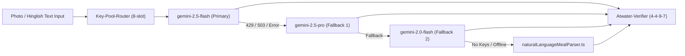

# 🧠 Gemini Recognition Swarm

#ai-model

Linked: [[00-Home]] | [[Architecture]] | [[Key-Pool-Router]] | [[Atwater-Verifier]] | [[AI-Meal-Scan]] | [[Admin-Console]] | [[Serverless-API]] | [[AI-Vision-Nutrition-Swarm]]

## Source Files
- `VibeDiet/src/services/geminiNutritionSwarm.ts`
- `VibeDiet/src/services/naturalLanguageMealParser.ts`
- `VibeDiet/src/services/draftProcessor.ts`

## Model Cascade & Fallback Architecture

## Responsibilities
- **4-Agent Visual & Text Pipeline:** Decomposes plate photos and English/Hinglish descriptions into discrete food items with gram mass estimates, oil/ghee clarifying questions, and Indian katori / reference anchor calibration.
- **Strict Ground-Truth Verification:** Every recognized item is passed through [[Atwater-Verifier]] (`normalizeFoodItem`) before reaching [[AI-Meal-Scan]] or [[DietContext]].
- **Telemetry Reporting:** Execution latency and request/error counts flow directly into [[Key-Pool-Router]], `vibe_key_pool`, `vibe_system_telemetry`, and [[Admin-Console]].
