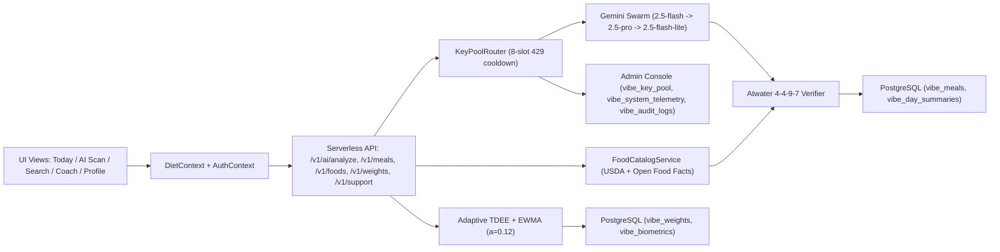

# 📐 VibeDiet Architecture

#hub

Linked: [[00-Home]] | [[Active-Context]] | [[Code-Graph]] | [[DietContext]] | [[Serverless-API]] | [[PostgreSQL-Schema]]

## 1. Tech Stack
- **Frontend:** React 19, TypeScript, Vite, Tailwind CSS 4 (spatial frosted-glass UI), Motion, Lucide Icons.
- **Backend:** Node.js 20+, Express (`server.ts`, `src/routes/v1.ts`), Helmet, CORS, rate limiters.
- **Serverless:** Netlify Functions v2 (`netlify/functions/v1.mts`, `admin.mts`), Netlify Database (`@netlify/database`).
- **AI / Physics:** `@google/genai` (`[[Gemini-Recognition-Swarm]]`), `[[Key-Pool-Router]]`, `[[Atwater-Verifier]]`, `[[Adaptive-TDEE-EWMA]]`.
- **Offline / PWA:** ServiceWorker (`sw.js`), `offlineSyncQueue.ts`, zero-dependency `dist/VibeDiet-App.html`.

## 2. End-to-End Neural Pipeline

## 3. Connected Pillars
- **AI Recognition Pipeline:** [[AI-Meal-Scan]] → [[DietContext]] → [[Serverless-API]] (`POST /v1/ai/analyze`) → [[Key-Pool-Router]] → [[Gemini-Recognition-Swarm]] → [[Atwater-Verifier]] → [[Today-Dashboard]] → [[Admin-Console]].
- **Catalog & Barcode Pipeline:** [[Food-Search-Catalog]] → [[Serverless-API]] (`/v1/foods/*`) → [[Atwater-Verifier]] → [[DietContext]] → [[PostgreSQL-Schema]] (`vibe_meals`).
- **Metabolic Autopilot Pipeline:** [[Metabolism-Coach]] → [[Adaptive-TDEE-EWMA]] → [[Serverless-API]] (`/v1/weights`, `/v1/biometrics`) → [[PostgreSQL-Schema]] → [[Today-Dashboard]].
- **Governance & Support Pipeline:** [[Profile-and-Support]] → [[Serverless-API]] (`/v1/support`) → [[PostgreSQL-Schema]] (`vibe_support_tickets`, `vibe_audit_logs`) → [[Admin-Console]].

## 4. Core Source File Map
- `src/App.tsx`: Consumer shell, ambient dual-tone glow backdrop, tab routing, modals, footer.
- `src/context/DietContext.tsx` & `src/context/AuthContext.tsx`: [[DietContext]] state, `usr_<uuid>` isolation, offline sync queue.
- `src/components/redesign/VibeDietDashboard.tsx` & `src/components/DailyDiaryScreen.tsx`: [[Today-Dashboard]] frosted-glass bento & calorie ring.
- `src/components/redesign/VibeDietAiScannerView.tsx` & `src/components/PhotoLogScreen.tsx`: [[AI-Meal-Scan]] photo/text capture & 1.5× preview.
- `src/components/ManualEntryScreen.tsx` & `src/components/BarcodeScannerModal.tsx`: [[Food-Search-Catalog]] USDA & barcode lookup.
- `src/components/MetabolismCoachScreen.tsx` & `src/components/WeeklyCheckInModal.tsx`: [[Metabolism-Coach]] EWMA coach & autopilot modal.
- `src/components/ProfileScreen.tsx`: [[Profile-and-Support]] biometrics, GDPR export/erasure, support tickets.
- `src/components/AdminDashboardScreen.tsx`: [[Admin-Console]] key pool, table inspector, support triage.
- `src/services/geminiNutritionSwarm.ts` & `src/services/keyPoolRouter.ts`: [[Gemini-Recognition-Swarm]] & [[Key-Pool-Router]].
- `src/shared/physics/atwater.ts` & `src/shared/physics/adaptiveTdee.ts`: [[Atwater-Verifier]] & [[Adaptive-TDEE-EWMA]].
- `netlify/functions/v1.mts`, `netlify/functions/admin.mts`, `src/routes/v1.ts`: [[Serverless-API]] & [[PostgreSQL-Schema]] persistence.
