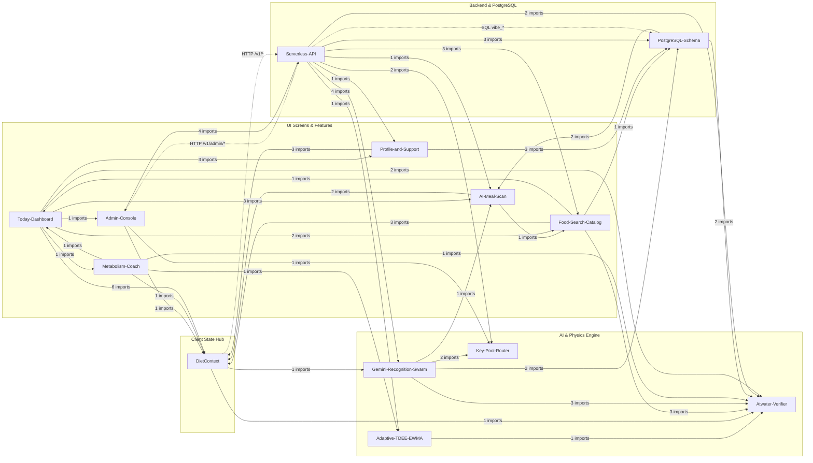

# 🕸️ Live Code Dependency Graph

#hub #backend

Linked: [[00-Home]] | [[Architecture]] | [[Active-Context]] | [[AI-Meal-Scan]] | [[Adaptive-TDEE-EWMA]] | [[Admin-Console]] | [[Atwater-Verifier]] | [[DietContext]] | [[Food-Search-Catalog]] | [[Gemini-Recognition-Swarm]] | [[Key-Pool-Router]] | [[Metabolism-Coach]] | [[PostgreSQL-Schema]] | [[Profile-and-Support]] | [[Serverless-API]] | [[Today-Dashboard]]

> Auto-generated by `npm run brain:sync` (`scripts/sync-brain-graph.ts`) from **91 TypeScript/TSX source modules** and **197 real internal import edges** across `VibeDiet/src/` and `VibeDiet/netlify/functions/`.

## 1. Live Architectural Dependency Graph

## 2. Verified File-to-Brain Cross-Link Index

| Source File | Layer | Brain Note | Local Imports | Connected Brain Nodes |
| :--- | :--- | :--- | :---: | :--- |
| `netlify/functions/admin.mts` | `api` | [[Admin-Console]] | 0 | — |
| `netlify/functions/v1.mts` | `api` | [[Serverless-API]] | 6 | [[Adaptive-TDEE-EWMA]], [[Atwater-Verifier]], [[Food-Search-Catalog]], [[Gemini-Recognition-Swarm]], [[Key-Pool-Router]] |
| `server.ts` | `api` | [[Serverless-API]] | 5 | [[Admin-Console]], [[Architecture]], [[PostgreSQL-Schema]] |
| `src/App.tsx` | `ui` | [[Today-Dashboard]] | 15 | [[AI-Meal-Scan]], [[Admin-Console]], [[Architecture]], [[DietContext]], [[Food-Search-Catalog]], [[Metabolism-Coach]], [[Profile-and-Support]] |
| `src/components/AdminDashboardScreen.tsx` | `ui` | [[Admin-Console]] | 2 | [[Architecture]], [[DietContext]] |
| `src/components/AuthModal.tsx` | `ui` | [[Profile-and-Support]] | 3 | [[Architecture]], [[DietContext]], [[PostgreSQL-Schema]] |
| `src/components/BarcodeScannerModal.tsx` | `ui` | [[Food-Search-Catalog]] | 3 | [[Architecture]], [[DietContext]] |
| `src/components/CommandPaletteModal.tsx` | `ui` | [[Today-Dashboard]] | 4 | [[AI-Meal-Scan]], [[DietContext]] |
| `src/components/DailyDiaryScreen.tsx` | `ui` | [[Today-Dashboard]] | 5 | [[Architecture]], [[Atwater-Verifier]], [[DietContext]], [[Food-Search-Catalog]] |
| `src/components/LegalModal.tsx` | `ui` | [[Profile-and-Support]] | 0 | — |
| `src/components/ManualEntryScreen.tsx` | `ui` | [[Food-Search-Catalog]] | 8 | [[Architecture]], [[Atwater-Verifier]], [[DietContext]], [[Today-Dashboard]] |
| `src/components/MetabolismCoachScreen.tsx` | `ui` | [[Metabolism-Coach]] | 5 | [[Architecture]], [[Atwater-Verifier]], [[DietContext]], [[Today-Dashboard]] |
| `src/components/Navigation.tsx` | `ui` | [[Today-Dashboard]] | 2 | [[DietContext]] |
| `src/components/OmnibarDock.tsx` | `ui` | [[Today-Dashboard]] | 1 | — |
| `src/components/PhotoLogScreen.tsx` | `ui` | [[AI-Meal-Scan]] | 7 | [[Architecture]], [[DietContext]], [[Food-Search-Catalog]] |
| `src/components/ProfileScreen.tsx` | `ui` | [[Profile-and-Support]] | 5 | [[Architecture]], [[DietContext]], [[PostgreSQL-Schema]] |
| `src/components/redesign/VibeDietAiScannerView.tsx` | `ui` | [[AI-Meal-Scan]] | 0 | — |
| `src/components/redesign/VibeDietDashboard.tsx` | `ui` | [[Today-Dashboard]] | 2 | [[Architecture]] |
| `src/components/redesign/VibeDietNavbar.tsx` | `ui` | [[Today-Dashboard]] | 0 | — |
| `src/components/WeeklyCheckInModal.tsx` | `ui` | [[Metabolism-Coach]] | 1 | [[Adaptive-TDEE-EWMA]] |
| `src/context/AuthContext.tsx` | `context` | [[DietContext]] | 0 | — |
| `src/context/DietContext.tsx` | `context` | [[DietContext]] | 7 | [[Architecture]], [[Atwater-Verifier]], [[Gemini-Recognition-Swarm]] |
| `src/lib/dataStore.ts` | `db` | [[PostgreSQL-Schema]] | 9 | [[AI-Meal-Scan]], [[Architecture]], [[Atwater-Verifier]] |
| `src/lib/mockFirestore.ts` | `db` | [[PostgreSQL-Schema]] | 4 | [[Architecture]], [[Atwater-Verifier]] |
| `src/middleware/auth.ts` | `api` | [[Admin-Console]] | 1 | [[Architecture]] |
| `src/middleware/security.ts` | `api` | [[Admin-Console]] | 1 | — |
| `src/persistence/postgresRepository.ts` | `db` | [[PostgreSQL-Schema]] | 3 | [[AI-Meal-Scan]], [[Architecture]] |
| `src/routes/v1.ts` | `api` | [[Serverless-API]] | 17 | [[AI-Meal-Scan]], [[Admin-Console]], [[Architecture]], [[Atwater-Verifier]], [[Food-Search-Catalog]], [[Gemini-Recognition-Swarm]], [[Key-Pool-Router]], [[PostgreSQL-Schema]], [[Profile-and-Support]] |
| `src/server/ai/keyPoolRouter.ts` | `ai-math` | [[Key-Pool-Router]] | 1 | — |
| `src/server/persistence/atomicStore.ts` | `db` | [[PostgreSQL-Schema]] | 0 | — |
| `src/server/persistence/repository.ts` | `db` | [[PostgreSQL-Schema]] | 2 | [[Architecture]] |
| `src/server/security/auditLogger.ts` | `api` | [[Admin-Console]] | 1 | — |
| `src/services/apiConnectors.ts` | `service` | [[Food-Search-Catalog]] | 4 | [[Architecture]], [[Atwater-Verifier]], [[PostgreSQL-Schema]] |
| `src/services/auditLogger.ts` | `api` | [[Admin-Console]] | 1 | [[Key-Pool-Router]] |
| `src/services/billingService.ts` | `service` | [[Profile-and-Support]] | 2 | [[Architecture]], [[PostgreSQL-Schema]] |
| `src/services/dataStore.ts` | `db` | [[PostgreSQL-Schema]] | 2 | — |
| `src/services/draftProcessor.ts` | `ai-math` | [[Gemini-Recognition-Swarm]] | 9 | [[AI-Meal-Scan]], [[Architecture]], [[Atwater-Verifier]], [[Key-Pool-Router]], [[PostgreSQL-Schema]] |
| `src/services/foodCatalogService.ts` | `service` | [[Food-Search-Catalog]] | 2 | [[Architecture]], [[Atwater-Verifier]] |
| `src/services/geminiNutritionSwarm.ts` | `ai-math` | [[Gemini-Recognition-Swarm]] | 6 | [[Architecture]], [[Atwater-Verifier]], [[Key-Pool-Router]] |
| `src/services/keyPoolRouter.ts` | `ai-math` | [[Key-Pool-Router]] | 1 | [[Architecture]] |
| `src/services/macroMealSolver.tsx` | `service` | [[Today-Dashboard]] | 4 | [[AI-Meal-Scan]], [[Architecture]], [[Atwater-Verifier]] |
| `src/services/naturalLanguageMealParser.ts` | `ai-math` | [[Gemini-Recognition-Swarm]] | 3 | [[Architecture]], [[Atwater-Verifier]] |
| `src/services/offlineSyncQueue.ts` | `context` | [[DietContext]] | 1 | [[Architecture]] |
| `src/services/portionMemory.ts` | `service` | [[AI-Meal-Scan]] | 0 | — |
| `src/services/supabaseClient.ts` | `db` | [[PostgreSQL-Schema]] | 0 | — |
| `src/services/weeklyAutopilot.ts` | `ai-math` | [[Adaptive-TDEE-EWMA]] | 2 | [[Architecture]], [[Atwater-Verifier]] |
| `src/shared/physics/adaptiveTdee.ts` | `ai-math` | [[Adaptive-TDEE-EWMA]] | 0 | — |
| `src/shared/physics/atwater.ts` | `ai-math` | [[Atwater-Verifier]] | 1 | [[Architecture]] |
| `src/utils/atwater.ts` | `ai-math` | [[Atwater-Verifier]] | 1 | [[Architecture]] |
| `src/utils/imageCompressor.ts` | `service` | [[AI-Meal-Scan]] | 0 | — |
| `src/utils/macroMealSolver.ts` | `ui` | [[Today-Dashboard]] | 1 | — |
