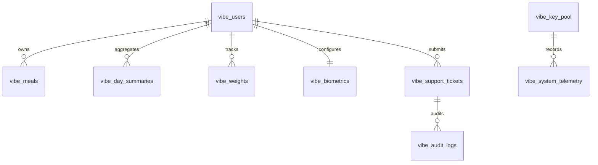

# 🗄️ PostgreSQL Multi-Tenant Schema

#database

Linked: [[00-Home]] | [[Architecture]] | [[Code-Graph]] | [[Serverless-API]] | [[DietContext]] | [[Key-Pool-Router]] | [[Adaptive-TDEE-EWMA]] | [[Today-Dashboard]] | [[AI-Meal-Scan]] | [[Food-Search-Catalog]] | [[Metabolism-Coach]] | [[Profile-and-Support]] | [[Admin-Console]]

## Source Files
- `VibeDiet/src/persistence/postgresRepository.ts`
- `VibeDiet/src/lib/dataStore.ts`
- `VibeDiet/netlify/functions/v1.mts`
- `VibeDiet/netlify/functions/admin.mts`

## Relational Entity Flow

## Table-to-Feature Ownership Matrix
| Table | Primary Key / Partition | Connected Features & Engines |
| :--- | :--- | :--- |
| `vibe_users` | `id` (`usr_<uuid>`) | [[DietContext]], [[Profile-and-Support]], [[Admin-Console]] |
| `vibe_key_pool` | `slot_id` (`key-slot-1..8`) | [[Key-Pool-Router]], [[Gemini-Recognition-Swarm]], [[AI-Meal-Scan]], [[Admin-Console]] |
| `vibe_meals` | `id`, `user_id`, `date` | [[Today-Dashboard]], [[AI-Meal-Scan]], [[Food-Search-Catalog]], [[Atwater-Verifier]] |
| `vibe_day_summaries` | `(user_id, date)` | [[Today-Dashboard]], [[AI-Meal-Scan]], [[DietContext]] |
| `vibe_days` | `(user_id, date)` | [[Today-Dashboard]] (per-date `waterMl`, defaults to `0`) |
| `vibe_weights` | `id`, `user_id`, `date` | [[Metabolism-Coach]], [[Adaptive-TDEE-EWMA]] (EWMA $\alpha = 0.12$) |
| `vibe_biometrics` | `user_id` | [[Metabolism-Coach]], [[Profile-and-Support]], [[Today-Dashboard]] |
| `vibe_support_tickets` | `id`, `user_id` | [[Profile-and-Support]] → [[Admin-Console]] (Support Inbox) |
| `vibe_audit_logs` | `id`, `event_type`, `actor_uid` | [[Admin-Console]], [[Profile-and-Support]], [[Serverless-API]] |
| `vibe_system_telemetry` | `metric_name`, `recorded_at` | [[AI-Meal-Scan]], [[Key-Pool-Router]], [[Admin-Console]] |
| `vibe_repeat_meals` | `id`, `user_id` | [[Today-Dashboard]], [[DietContext]] |
| `vibe_portion_calibrations` | `(user_id, item_name)` | [[AI-Meal-Scan]] |
