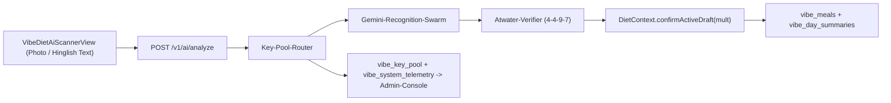

# 📸 AI Meal Scan

#feature #ui

Linked: [[00-Home]] | [[Architecture]] | [[DietContext]] | [[Gemini-Recognition-Swarm]] | [[Key-Pool-Router]] | [[Atwater-Verifier]] | [[Today-Dashboard]] | [[Admin-Console]] | [[Serverless-API]] | [[PostgreSQL-Schema]]

## Source Files
- `VibeDiet/src/components/PhotoLogScreen.tsx`
- `VibeDiet/src/components/redesign/VibeDietAiScannerView.tsx`
- `VibeDiet/src/utils/imageCompressor.ts`
- `VibeDiet/src/services/portionMemory.ts`

## End-to-End Pipeline

## State Hooks, API Endpoints & Database Tables
- **Context:** `useDiet()` ([[DietContext]]) for `activeDraft`, `startPhotoDraft`, `startTextDraft`, `confirmActiveDraft(multiplier)` (with largest-remainder exact calorie allocation).
- **API ([[Serverless-API]]):** `POST /v1/ai/analyze`, `POST /v1/drafts`, `POST /v1/drafts/text`, `GET /v1/drafts/:id`, `POST /v1/drafts/:id/confirm`, `POST /v1/meals/manual`.
- **Database ([[PostgreSQL-Schema]]):** `vibe_meals`, `vibe_day_summaries`, `vibe_portion_calibrations`, `vibe_key_pool`, `vibe_system_telemetry`.
